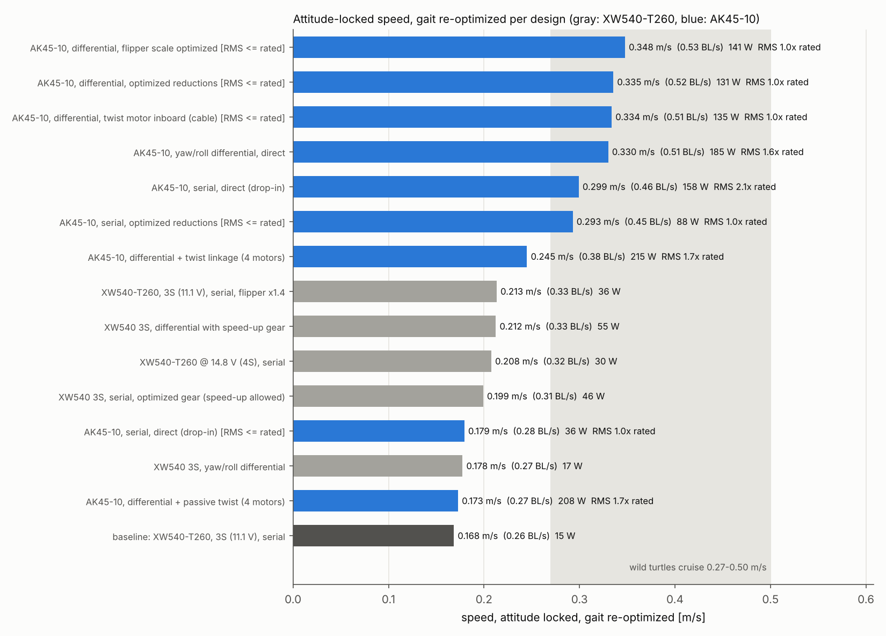
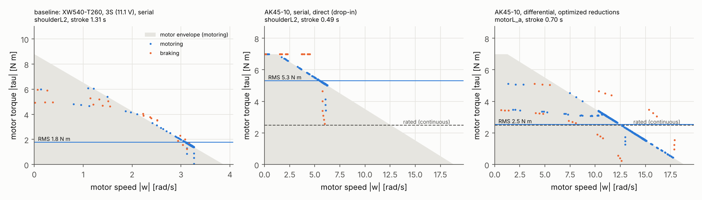

# TurtleCompliantSwimming: design upgrades for speed (Nov 2026)

Which hardware and design changes would let the sea-turtle robot swim much faster, and by how
much? This is a simulation study on the `turtle_compliant.xml` model (turtle_simulator commit
`9d58f90`, compliant blade G = 0.2 MPa, 8 segments). Nothing was changed in CAD; every design is
a parametric copy of the model generated by `design_study.py`. It follows
[RESULTS.md](RESULTS.md) (what the current robot can do).

Target for context: wild loggerhead and green turtles cruise at 0.27–0.50 m/s; inter-nesting
green turtles at 0.52–0.60 carapace lengths per second. The robot is 0.65 m long (shell plus
head), so 0.5 BL/s ≈ 0.33 m/s. The robot as built (XW540-T260 on 3S) swims **0.208 m/s** in the
pool at **24.0 W** (whole robot, arXiv:2602.21389).

## Answer

__ANSWER__

## Ranked designs

### Finalists: periodic trajectory optimization on the free body, and MPC

Each finalist's gait was optimized with `turtle_gait_opt.py` (the periodic counterpart of the
paddle crab's `gait_opt.py`): free-form Fourier joint trajectories, left/right mirrored, rear
hips included, scored on the free body's open-loop limit cycle (straight, level, periodic) with
the motor envelope applied every step; then confirmed in C++ (`turtle_trajopt`), open loop for
20 s and with MPC (predictive sampling) seeded with that gait.

__FINALISTS__

Speeds are in simulation along the heading; "pool-scaled" multiplies the pool-measured 0.208 m/s
by the design's speed ratio to the baseline in the same column (see *Calibration*). Electrical
power is the motors' shaft power plus copper loss (I²R from each motor's constant), positive
part only; it excludes electronics (~10 W on the robot). CoT = electrical energy / (m g d).

### All designs: attitude-locked search

Inner loop for every design: CMA-ES over stroke rate, sweep / stroke / twist amplitude and twist
timing (the biological waveform), plus the design's own continuous knobs (gear ratios, flipper
scale, linkage ratio), with the shell's attitude locked (thrust-limited speed, no pitch
problem). 150–400 evaluations per design. "[RMS <= rated]" runs penalize RMS motor torque
above the AK45-10's continuous rating (2.5 N m): a cruise that can be held; runs without it are
peak-limited sprints. Full table: [results/design_study/summary.md](results/design_study/summary.md).



__LOCKED_TABLE__

## Motors: AK45-10 KV75 vs XW540-T260

From the CubeMars product page (Nov 2026) and the ROBOTIS e-manual:

| | XW540-T260 @ 11.1 V (3S) | XW540-T260 @ 14.8 V | AK45-10 V3.0 KV75 @ 24 V |
|---|---|---|---|
| gear | 260.6:1 | 260.6:1 | 10:1 planetary, 18 arcmin backlash |
| stall / peak torque | 8.8 N m (4.5 A) | 11.2 N m | 7 N m peak (5 A), **2.5 N m rated** (1.9 A) |
| no-load speed | 37 rpm (3.9 rad/s) | 48 rpm (5.0 rad/s) | **180 rpm (18.8 rad/s)**, rated 120 rpm |
| peak mechanical power (line) | 8.5 W | 14 W | 35 W |
| motor constant at output | 1.25 N m/√W | 1.20 N m/√W | 0.86 N m/√W (Km 0.0858 at the rotor) |
| rotor inertia at output | not published (est. 5.4e-3 kg m²) | | 1.57e-3 kg m² (157 g cm² × 10²) |
| mass / size | 185 g, 33.5 × 58.5 × 45.9 mm | | 262 g, Ø53 × 45.2 mm |
| sealing | IP68 (1 m, 24 h); needs epoxy on the connector in salt water | | **no IP rating** |
| control | position / current via RS-485 | | SERVO and MIT (position + velocity + feed-forward torque) over CAN |
| backdrivable | no (260:1) | | 0.1 N m backdrive torque |

**Envelope model.** A current-limited motor at fixed voltage: torque ≤ min(peak, voltage line
through no-load) when motoring, ≤ peak when braking. For the AK45-10 the line goes through
no-load (180 rpm) and the rated point (2.5 N m at 120 rpm), i.e. a 7.5 N m stall intercept: it
is above the 7 N m peak only below 12 rpm. So at 24 V the AK45-10 behaves almost like a straight
torque-speed line (the 2.2 Ω phase resistance limits the current at speed), not a flat
quasi-direct-drive region. For the XW540 the line is the e-manual's stall / no-load pair (the
previous study's back-EMF model). The envelope is applied by `design_study.Envelope` in Python
and `ClampToMotorEnvelope` (`mjcb_control`) in `turtle_trajopt`, so it holds in every MPC
rollout: MuJoCo can't clip a position actuator's force by speed, so the clamp moves `ctrl` to the
value giving the limiting force. Servo gains stay at the previous study's kp = 100 N m/rad,
kv = 1 N m s/rad in joint space (divided by gear² in motor space). The rear hips keep XW540s.

**Motor mass and rotor inertia** are in every design: the XW540 (185 g, its CAD mesh's inertia)
is removed from the shell (motor 1), link 1 (motor 2) and link 2 (motor 3), and the AK45 (262 g,
pancake, coaxial with the joint it drives) is added. Reflected rotor inertia (gear² × rotor) is
joint armature. Six AK45s add 0.46 kg (8.99 → 9.46 kg). The XW540's rotor inertia isn't
published; the 0.8 g cm² estimate (5.4e-3 kg m² at the output) is the main uncertainty in the
baseline's twist dynamics.



What the operating points show (main-stroke motor, best gait of each): the XW540 rides its
torque-speed line at 3–4 rad/s, so it is **speed-limited**. The direct-drive AK45 is the
opposite: it sits at its 7 N m peak and only reaches 6 rad/s of its 18.8 — **torque-limited**,
RMS 5.3 N m = 2.1× rated. A ~1.7–2.9:1 external reduction moves the operating point down the
line to 10–19 rad/s, where the motor delivers its power at a sustainable torque.

**External reduction.** Peak-limited speed is flat from 1:1 to 2:1 (0.30 ± 0.01 m/s serial,
0.33 m/s differential) while electrical energy per metre falls 25–30 %, because the motor runs
nearer its efficient high-speed end; beyond ~2.5:1 the speed limit bites and speed drops. Under
the thermal limit the reduction is essential: the direct-drive AK45 held to 2.5 N m RMS swims
only 0.179 m/s (no better than the XW540), with 2.3:1 on the stroke 0.293 m/s. Optimal ratios:
stroke 1.7–2.9:1, twist 1.4–2.9:1 (the twist joint's load is small, so its ratio matters less).


## Articulation

**Finding 2 holds in every fast gait** (share of the front limbs' positive joint work):


The main stroke does 82–94 % of the work, the fore-aft sweep 0.2–4 %, the twist 5–18 % (18 % only
in the AK45 drop-in's 0.39 s stroke). In a serial shoulder the sweep motor is idle while the
stroke motor is saturated.

* **Yaw/roll differential** (two motors on tendons: roll = both together, yaw = their
  difference; MuJoCo fixed tendons with one actuator each, reflected inertia 2 g² J_rotor on both
  joints, efficiency 0.9): both motors drive the stroke. With the AK45 it is the largest single
  articulation gain: +10 % peak-limited (0.330 vs 0.299 m/s direct), **+14 % at the rated torque**
  (0.335 vs 0.293 m/s attitude-locked, 0.325 vs 0.289 m/s trajopt), and it keeps the sweep DOF for
  steering. Both differential motors sit in the shell, which also takes motor 2 (262 g) off
  link 1.
* **With the existing XW540s** a plain differential gains only 6 % (0.178 vs 0.168 m/s): the XW540
  is speed-limited, so doubling the stroke torque at the same speed does little. The differential
  plus a **speed-up stage** (≈ 1:1.8, motor turns per joint turn 0.56) converts the doubled torque
  into joint speed: **0.212 m/s locked, 0.218 m/s trajopt (+26–42 %)**, at 3.5× the electrical
  power. A speed-up alone on a serial shoulder gives 0.199 m/s. This is the only option here
  that keeps the current motors.
* **Passive twist** (twist motor removed, the compliant blade twists under load; 4 motors): fails
  at every blade stiffness tried (0.1×–3× G): 0.16–0.18 m/s vs 0.33 with a twist motor. The
  optimum wants large (±1.2 rad), well-timed twist that the silicone alone doesn't produce.
* **Twist linkage** (twist = c · stroke via a joint equality, 4 motors): 0.245 m/s. A linkage can
  only produce twist in phase with the stroke angle; the optimum leads it.
* **Twist motor inboard** (cable drive from the shell, efficiency 0.9, 30 g pulley on link 2):
  no measurable gain (0.334 vs 0.335 m/s). The AK45 for joint 3 sits almost on the stroke axis
  (pancake motor coaxial with the twist axis), so it adds little stroke inertia; the cable loss
  cancels the rest.

## Other levers

* **Flipper size** (blade span and chord scaled about the flipper root, thin plate: mass ∝ s²,
  fluid ellipsoids follow the meshes): helps the XW540 robot (×1.4: 0.213 m/s locked, +27 %, at
  2.4× power) because it lets a speed-limited motor push more water per stroke. With the AK45
  differential, ×1.38 gives +4 % locked but the advantage disappears on the free body (0.328 vs
  0.325 m/s trajopt). __SEGMENTS__
* **Supply voltage**: XW540 at 14.8 V (4S) 0.208 m/s vs 0.168 at 3S (+24 %; the XW540 is rated to
  14.8 V). The cheapest upgrade, but the stall-torque rating at 14.8 V is not a continuous rating
  either.
* **Blade stiffness** (with a twist motor) and pitch stability (buoyancy / CoM) were not
  re-studied; the trajopt gaits use the rear hips for trim and stay within 11–17° of level open
  loop.

## Combined best design

**AK45-10 at 24 V, yaw/roll differential with both stroke motors in the shell, ~1.7:1 on the
stroke (both differential motors) and ~1.8:1 on the twist motor, standard flippers**
(`ak45_diff_red_thermal`):

__COMBINED__

What it would take to build:
* Six AK45-10s (two per differential + one twist motor per arm), a 24 V bus (6S LiPo) and a CAN
  interface; the rear hips stay XW540s on a 12 V rail.
* A bevel or cable differential at each shoulder with a ~1.7:1 stage (belt or spur); a ~1.8:1
  stage on each twist motor. Both stroke motors move into the shell (more sealed volume at the
  shoulders); the twist motor rides on link 2 as now.
* **Sealing**: the AK45-10 has no IP rating (the XW540 is IP68 and still needed epoxy). Each
  motor needs a sealed housing or oil filling with a rotary shaft seal; this is the main build
  risk.
* **Power**: ~160 W for the motors when swimming at 0.33 m/s, vs ~25 W now: a 6S 5 Ah pack
  (~110 Wh) lasts about 40 minutes at full speed. Energy per metre is 2.6–3× the baseline's.
* **Heat**: the cruise designs run at the AK45's rated torque (2.5 N m RMS, ~8.5 W copper loss per
  motor). Underwater the housings will run cooler than in air, which gives margin, but the sealed
  housing must conduct that heat out.

## Calibration and confidence

* **Absolute speed is uncertain; ratios are more reliable.** The searched baseline gait reaches
  0.168 m/s attitude-locked, 0.154 m/s as a free-body trajopt gait and 0.162 m/s under MPC, vs
  0.208 m/s measured. The real robot runs the Van der Geest gait at an adjustable rate with
  rear-flipper stabilization; in simulation that gait shape (turtle_sim's scaling) peaks at only
  0.094 m/s (3S) before the motors saturate (`calibrate.py`). So the simulation underestimates
  speed by a factor between 1.3 (if the real gait were as good as the optimized one) and 2.2 (if
  it is the reference shape): the fluid model (MuJoCo ellipsoids on the sliced blade) produces too
  little thrust or too much drag. Power is in the right range (motors ~9–25 W in simulation vs
  24 W for the whole robot including ~10 W of electronics).
* "Pool-scaled" speeds assume the simulated speed ratios carry over to the pool. That is the
  basis of the 0.4 m/s estimate for the combined design.
* **Robust findings** (consistent across attitude-locked search, free-body trajopt, open-loop C++
  playback and MPC): the motors limit speed; the AK45 roughly doubles speed only with an external
  reduction (or at more than twice its thermal rating); the differential is worth 10–14 % with the
  AK45 and up to 40 % with the XW540 plus a speed-up stage; passive or linked twist does not work
  with this blade; inboard motors are not worth it.
* **Less certain**: flipper size (geometry changes interact with the blade slicing); the XW540's
  rotor inertia; the AK45 envelope above rated speed (from two datasheet points); the 0.9
  efficiency of the differential and cable stages; servo gains (kp = 100 N m/rad joint-space for
  all designs; the AK45's MIT mode allows much stiffer gains).
* Stroke amplitude hits its travel limit (±1.6 rad on joint 2, the previous study's placeholder)
  in almost every fast gait. A larger stroke range, if the shoulder allows it, is an untested
  lever.

## Method

1. **Design variants** (`design_study.py build/search`): motor swap with mass, inertia and
   reflected rotor inertia; external gear per joint (actuator `gear`, efficiency 0.95); yaw/roll
   differential (two `fixed` tendons, position actuators on the tendons, efficiency 0.9); passive
   twist (actuator removed, blade stiffness scale) or a linkage (joint equality); motors moved
   inboard; flipper scale; motor envelope numerics `motor_<actuator>` in the model.
2. **Attitude-locked search** for every design (CMA-ES, 150–400 evaluations, 0.5 s each).
3. **Periodic trajopt** for the finalists on the free body (`turtle_gait_opt.py`, K = 5
   harmonics, 56 parameters; 60 ES generations × 32, then 15 Levenberg-Marquardt iterations;
   ~20–40 min each).
4. **C++ confirmation**: `turtle_trajopt --task_xml=designs/<design>_trajopt/task.xml`, open loop
   (`--mode=reference`, 20 s) and MPC (16 s, Gait 0.1, Power 0.001, 30 spline points, target
   0.6 m/s). MPC needed two changes from the previous study's settings for the fast gaits: the
   Power weight (0.01) was tuned for ~12 W and made MPC trade speed for power at 100+ W, and
   10 spline points per 1 s horizon can't represent a 0.6–0.7 s stroke's waveform.

## Reproduce

```bash
cd mjpc/tasks/turtle_compliant_swimming
TS=../../../../turtle_simulator
pip install mujoco==3.3.7 cma scipy matplotlib imageio imageio-ffmpeg transforms3d

python design_study.py --turtle-sim $TS list
python calibrate.py --turtle-sim $TS
# attitude-locked searches (each a few minutes)
python design_study.py --turtle-sim $TS search xw540_3s --budget 200
python design_study.py --turtle-sim $TS search ak45_serial --budget 200
python design_study.py --turtle-sim $TS search ak45_diff_red --budget 300 --thermal
python design_study.py --turtle-sim $TS search xw540_3s_diff_red --budget 300
python design_study.py --turtle-sim $TS sweep ak45_serial --param g_roll --values 1.5 2 2.5 3
# (all searches: see the design list; --thermal for the "[RMS <= rated]" runs)
# periodic trajopt on the free body, then export for turtle_trajopt
python turtle_gait_opt.py --turtle-sim $TS run ak45_diff_red_thermal --thermal
python turtle_gait_opt.py --turtle-sim $TS export ak45_diff_red_thermal
# C++: open loop and MPC (cadence is in designs/<name>/reference_gait.xml)
D=designs/ak45_diff_red_thermal_trajopt
../../../build/bin/turtle_trajopt --mode=reference --task_xml=$PWD/$D/task.xml --param=Cadence=2.6106 --duration=20
../../../build/bin/turtle_trajopt --mode=mpc --task_xml=$PWD/$D/task.xml --param=Cadence=2.6106,Speed=0.6 \
    --weight=Gait=0.1,Power=0.001 --numeric=sampling_spline_points=30 --duration=16 --out=mpc.csv
# figures and tables
python design_plots.py --turtle-sim $TS --mpc "baseline=mpc_base.csv:xw540_3s_trajopt" ...
MUJOCO_GL=egl python render_run.py side_by_side.mp4 "current robot=mpc_base.csv" "AK45 + differential=mpc.csv"
```

Don't pass `--kp` with a design task (the design sets per-actuator gains in motor coordinates;
the runner refuses). Blade-slicing variants: generate `turtle_compliant.xml` with another
`n_segments` in a scratch copy of turtle_simulator (the generator overwrites the tracked blade
meshes), run `prepare_model.py` in a scratch directory and point `TURTLE_DESIGN_BASE` at it.

## Files

| File | What |
|---|---|
| `design_study.py` | design variants, motor library and envelope, attitude-locked search, export |
| `turtle_gait_opt.py` | periodic gait trajopt on the free body (ES + Levenberg-Marquardt) |
| `calibrate.py` | reference-shape gait vs the pool measurement |
| `design_plots.py` | figures and `summary.md` |
| `designs/<name>/` | exported design: `model.xml`, `task.xml`, `reference_gait.xml` (motor coordinates), `gait.csv` |
| `results/design_study/*.json` | search results (best gait, motor demands, evaluation history) |
| `results/trajopt/*.json` | trajopt results (theta, metrics, ES / LM history) |
| `turtle_trajopt.cc` | `--task_xml`, motor envelope in `mjcb_control`, actuator force / velocity in the CSV |
