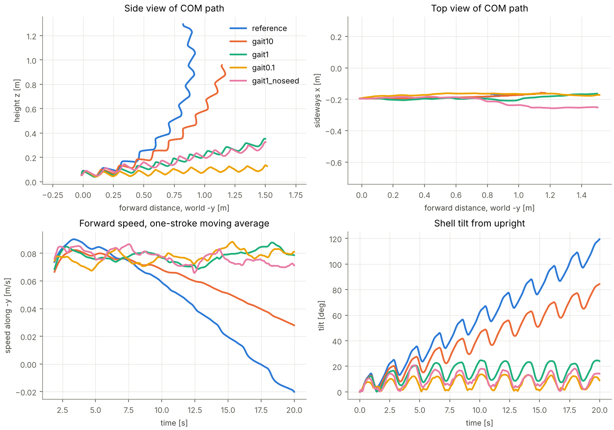
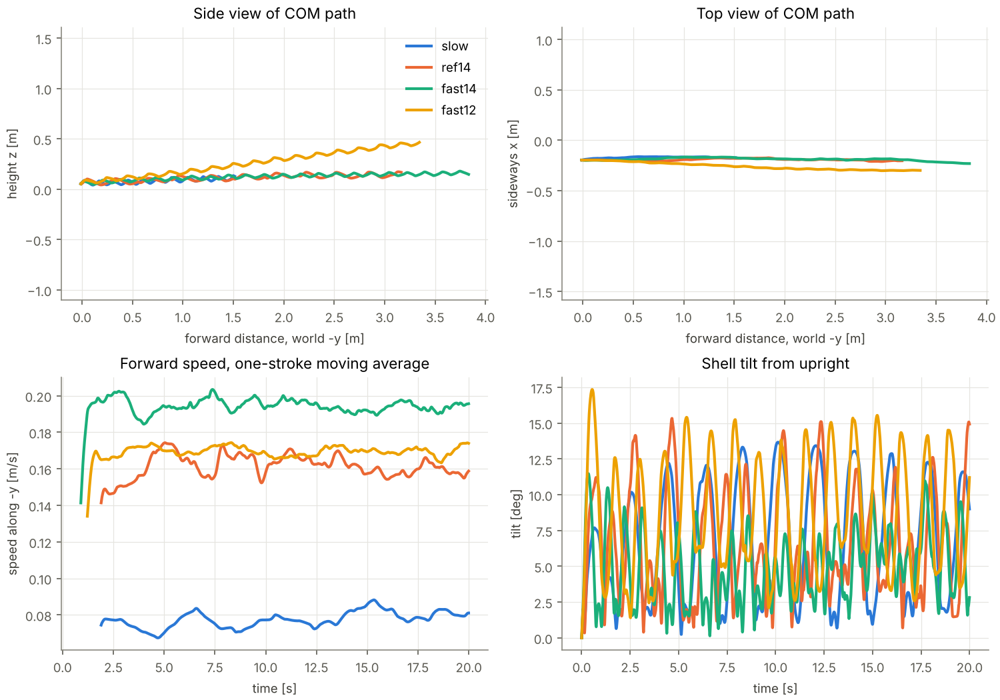

# TurtleCompliantSwimming: first trajectory-optimization results (Oct 2026)

Model: `turtle_compliant.xml` from turtle_simulator at commit `9d58f90`, default blade
compliance (G = 0.2 MPa, 8 segments), servo actuators (placeholder gains, see README).
Planner: predictive sampling, 32 rollouts, 1.0 s horizon, 10-point cubic spline,
exploration 0.05, replanning every 20 ms (synchronous), 4 threads, 20 warm-up iterations.
Default weights except Gait. Desired speed 0.15 m/s (above what any run reached, so the
Speed term keeps pushing). 20 s per run; metrics over the 8 whole strokes from 3.82 s to 19.11 s.

Videos (not committed, 17 MB): render with `render_run.py` from the CSV logs.

Reproduce (each MPC run takes ~8 min wall on 4 cores):

```bash
./turtle_trajopt --mode=reference --duration=20 --out=reference.csv
./turtle_trajopt --mode=mpc --duration=20 --weight=Gait=0.1 --out=mpc_gait0.1.csv   # also 10, 1
./turtle_trajopt --mode=mpc --duration=20 --weight=Gait=1 --seed_reference=false --out=mpc_gait1_noseed.csv
python analyze_runs.py reference=reference.csv gait0.1=mpc_gait0.1.csv ... --extract gait0.1
./turtle_trajopt --mode=reference --gait_csv=figs/gait_gait0.1.csv --duration=20
```

## Summary

| run | speed along heading [m/s] | off-heading drift [m/s] | max tilt [deg] | max yaw error [deg] | mean +power [W] | energy [J/m] | CoT |
|---|---|---|---|---|---|---|---|
| reference gait, open loop | 0.038 | 0.075 | 109 | n/a (pitched past vertical) | 5.35 | 141 | 1.59 |
| MPC, Gait weight 10 | 0.059 | 0.054 | 77 | 8 | 3.67 | 63 | 0.71 |
| MPC, Gait weight 1 | 0.078 | 0.016 | 25 | 8 | 3.34 | 43 | 0.49 |
| **MPC, Gait weight 0.1** | **0.078** | **0.003** | **14** | **3** | **2.58** | **33** | **0.38** |
| MPC, Gait weight 1, plan not seeded | 0.076 | 0.013 | 21 | 9 | 4.91 | 65 | 0.73 |
| **optimized gait (from Gait 0.1), open loop** | **0.073** | 0.028 | 18 | 28 | 2.31 | **32** | **0.36** |

Energy is positive mechanical work of the 10 actuators, integrated every 5 ms physics step;
CoT = work / (m g d) with m = 8.99 kg. Drift is the COM velocity off the heading (here
almost all of it vertical, i.e. climbing).



## Findings

* **The reference gait doesn't swim straight on this model.** It produces a steady nose-up
  pitching moment. Gravity is off (neutral buoyancy, no righting moment), so the shell keeps
  pitching up, about 11° per stroke. After 20 s it is past vertical, climbing, with forward
  speed reversing. Forward speed along the heading is only 0.038 m/s; most of the
  0.084 m/s net speed goes upward.
* **Holding the reference tightly (Gait 10) isn't enough.** MPC slows the pitch-up by about a
  quarter (≈ 8° per stroke) but can't stop it while staying close to the reference.
* **Letting the optimizer deviate (Gait 1, 0.1) fixes it.** The shell stays within 14–25° of
  level, the path is straight, and speed along the heading doubles (0.078 m/s). Energy per
  metre drops 3–4× (141 → 33 J/m at Gait 0.1), mostly because the robot now goes where it is
  pointed. Mean power also drops, from 5.4 W to 2.6 W.
* **What changed in the gait** (`results/gait_mpc_gait0.1.png`): shoulder 2 (the main
  stroke) has a smaller downstroke (about 45° instead of 60°). Shoulder 1's recovery is
  truncated (−6° instead of −20° on the left), and the flipper-twist timing is shifted a
  little. The rear hips, held at zero in the reference, make ±2–7° pitch-trim pulses timed to
  the stroke (hip_L2/R2 peak at phase ≈ 0.65). The optimized gait is no longer exactly
  left/right symmetric.
* **The optimized gait works open loop.** Played back as a fixed periodic table (Fourier fit
  of the last 4 MPC strokes, `results/optimized_gait.csv`), it keeps 94 % of the MPC speed
  and the best energy per metre (32 J/m), stays level (max tilt 18°), and needs no feedback.
  Its left/right asymmetry makes it slowly turn, yawing up to 28° and drifting 0.35 m sideways over
  the 15 s measured, so on its own it needs a heading correction (or a symmetrized version).
* **Seeding the plan with the reference matters for efficiency.** Without it (as in the
  GUI), Gait 1 reaches a similar speed but with ~50 % more power and energy per metre.

## Caveats

* Servo gains (kp 20, kv 1, ±10 N m), ctrl ranges and the rear hips' servo are placeholders,
  and so is the silicone shear modulus. Energy numbers are mechanical work, not electrical.
* One run per setting (sampling is random). Differences of a few percent between MPC runs are
  within run-to-run noise; I haven't measured that spread yet.
* MuJoCo's ellipsoid fluid model depends on how the blade is sliced (turtle_simulator's
  `cad_exports/README.md`), so absolute speeds carry that uncertainty too.
* MJPC builds MuJoCo 3.2.3; turtle_simulator was checked with 3.3.7. The reference playback
  matches across the two.

# Swimming faster (Oct 2026, second round)

Goal: get closer to real sea-turtle speeds. For reference, wild loggerhead and green turtles
cruise at 0.27–0.50 m/s, and inter-nesting green turtles at 0.52–0.60 carapace lengths per
second. This robot is about 0.65 m long (shell plus head), so 0.5 BL/s ≈ 0.33 m/s.

## Motor model

The first round's servos (±10 N m, no speed limit) are optimistic. Per the turtle_3dswimming task, the
motors are Dynamixel XW540-T260; the model applies that to all 10 joints (ROBOTIS e-manual: 40 rpm no-load and 9.5 N m stall at 12 V, 48 rpm and
11.2 N m at 14.8 V). The reference gait already asks for 4.8 rad/s on shoulder 2, above the
12 V no-load speed. `turtle_trajopt --motor=12V|14.8V` and `gait_study.py --motor` add the DC
motor's torque-speed line: force limit = stall torque, plus joint damping = stall torque /
no-load speed (back-EMF). The Power cost and energy figures now count shaft power, i.e. that
damping is a loss inside the motor, not output. All runs below use `--kp=100` (a stiffer
position loop; at kp 20 the servo lags the targets).

## Where the speed comes from (`gait_study.py`, attitude locked, open loop)

With the shell's rotation locked (translation only), each gait's thrust-limited speed can be
measured without the pitch-stability problem:

* Stroke rate alone: with the placeholder servos, speed rises from 0.093 m/s (reference) to
  0.19 m/s at 3× the stroke rate. With the real motors it saturates at about 0.09 (12 V) to
  0.115 m/s (14.8 V), because the motors can't follow a faster version of the same stroke.
* CMA-ES over stroke rate, yaw/roll/twist amplitude and twist timing (200 evaluations):

| motor | best stroke rate | yaw | roll | twist | speed, attitude locked |
|---|---|---|---|---|---|
| XW540-T260 12 V | 1.56× (1.23 s stroke) | 0.03 | 1.19 | 1.38 | 0.175 m/s |
| XW540-T260 14.8 V | 2.10× (0.91 s stroke) | 0.00 | 1.20 | 1.17 | 0.203 m/s |
| no speed limit (±10 N m) | 2.97× (0.64 s stroke) | 0.03 | 1.20 | 1.21 | 0.385 m/s, needs joint speeds ~30 rad/s |

  Amplitudes are relative to the biological data (the reference gait uses yaw 0.5, roll 0.83,
  twist 0.33). In every case the optimizer drops the fore-aft sweep, uses the full main stroke
  (the 1.2 search bound), and uses about 3.5× more flipper twist than the reference. Open loop,
  these fast gaits tumble on the free body (larger pitching moment), so they need the MPC.

## MPC on the free robot

Starting gait from the search, motor model in the rollouts, desired speed 0.4 m/s, otherwise
as above:

| run | speed along heading | max tilt | mean shaft power | energy | CoT |
|---|---|---|---|---|---|
| earlier result (placeholder servos, desired 0.15 m/s, Gait 0.1) | 0.078 m/s | 14° | 2.6 W | 33 J/m | 0.38 |
| reference gait start, 14.8 V, Gait 0.1 | 0.163 m/s | 15° | 16.2 W | 100 J/m | 1.13 |
| **fast gait start, 14.8 V, Gait 0.1** | **0.194 m/s** | **11°** | 18.3 W | 94 J/m | 1.07 |
| fast gait start, 14.8 V, Gait 1 | 0.192 m/s | 15° | 19.5 W | 102 J/m | 1.15 |
| fast gait start, 12 V, Gait 1 | 0.170 m/s | 16° | 13.0 W | 76 J/m | 0.87 |
| MPC-optimized fast gait, **open loop**, 14.8 V | 0.192 m/s | 38° | 17.5 W | — | — |



* **0.19 m/s straight and level, 2.5× the earlier result,** within the XW540-T260's 14.8 V
  torque-speed limits. That's 0.30 BL/s: roughly half of a cruising sea turtle's size-normalized
  speed, and below the low end of their absolute cruising speeds.
* Most of the gain comes from stroke rate and the stiffer servo loop (the reference gait under
  MPC already reaches 0.16 m/s). The searched gait adds another 20 %.
* It costs about 3× more energy per metre than the slow gait (94 vs 33 J/m) and ~7× the power.
  The motors run at their torque-speed envelope through much of the stroke. Stall torque is
  not a continuous rating, so heating and battery draw need checking before trying this on the
  robot.
* The gait extracted from the fastest MPC run (`results/fast_gait_mpc_14V8.csv`, play with
  `--param=Cadence=2.095`) keeps the speed open loop, but tilts up to 38° and yaws 17° without
  feedback.
* **Reaching real-turtle speed in this model needs faster actuators, not a better gait.** With
  the speed limit removed, the search reaches 0.385 m/s (≈ 0.6 BL/s), but at joint speeds around
  30 rad/s, about 6× the XW540-T260's no-load speed. Also note MuJoCo's ellipsoid fluid model
  is the main uncertainty in absolute speed (see the caveats above).

Files: `results/fast_gait_search_14V8.csv`, `results/fast_gait_search_12V.csv` (search
results; cadence 2.095 and 1.558), `results/fast_gait_mpc_14V8.csv` (extracted from the MPC run).

Reproduce:

```bash
python gait_study.py --turtle-sim ../../../../turtle_simulator --motor 14.8V --kp 100 \
    search --budget 200 --vmax 99 --fmax 99 --max-cadence 2.5
python gait_study.py --turtle-sim ... export --cadence 2.095 --yaw 0 --roll 1.198 \
    --twist 1.167 --twist-shift 0.034 --out fast_gait.csv
./turtle_trajopt --mode=mpc --duration=20 --kp=100 --motor=14.8V --gait_csv=fast_gait.csv \
    --param=Cadence=2.095,Speed=0.4 --weight=Gait=0.1 --out=fast.csv
```
