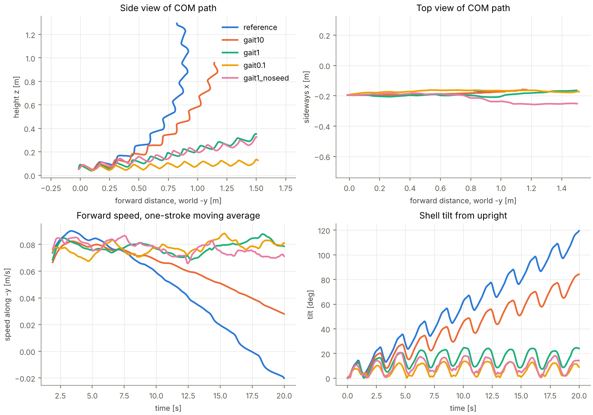

# TurtleCompliantSwimming: first trajectory-optimization results (Oct 2026)

Model: `turtle_compliant.xml` from turtle_simulator at commit `9d58f90`, default blade
compliance (G = 0.2 MPa, 8 segments), servo actuators (placeholder gains, see README).
Planner: predictive sampling, 32 rollouts, 1.0 s horizon, 10-point cubic spline,
exploration 0.05, replanning every 20 ms (synchronous), 4 threads, 20 warm-up iterations.
Default weights except Gait. Desired speed 0.15 m/s (above what any run reached, so the
Speed term keeps pushing). 20 s per run; metrics over the 8 whole strokes from 3.82 s to 19.11 s.

Videos (not committed, 17 MB): render with `render_run.py` from the CSV logs.

Reproduce (each MPC run takes ~8 min wall on 4 cores):

```bash
./turtle_trajopt --mode=reference --duration=20 --out=reference.csv
./turtle_trajopt --mode=mpc --duration=20 --weight=Gait=0.1 --out=mpc_gait0.1.csv   # also 10, 1
./turtle_trajopt --mode=mpc --duration=20 --weight=Gait=1 --seed_reference=false --out=mpc_gait1_noseed.csv
python analyze_runs.py reference=reference.csv gait0.1=mpc_gait0.1.csv ... --extract gait0.1
./turtle_trajopt --mode=reference --gait_csv=figs/gait_gait0.1.csv --duration=20
```

## Summary

| run | speed along heading [m/s] | off-heading drift [m/s] | max tilt [deg] | max yaw error [deg] | mean +power [W] | energy [J/m] | CoT |
|---|---|---|---|---|---|---|---|
| reference gait, open loop | 0.038 | 0.075 | 109 | n/a (pitched past vertical) | 5.35 | 141 | 1.59 |
| MPC, Gait weight 10 | 0.059 | 0.054 | 77 | 8 | 3.67 | 63 | 0.71 |
| MPC, Gait weight 1 | 0.078 | 0.016 | 25 | 8 | 3.34 | 43 | 0.49 |
| **MPC, Gait weight 0.1** | **0.078** | **0.003** | **14** | **3** | **2.58** | **33** | **0.38** |
| MPC, Gait weight 1, plan not seeded | 0.076 | 0.013 | 21 | 9 | 4.91 | 65 | 0.73 |
| **optimized gait (from Gait 0.1), open loop** | **0.073** | 0.028 | 18 | 28 | 2.31 | **32** | **0.36** |

Energy is positive mechanical work of the 10 actuators, integrated every 5 ms physics step;
CoT = work / (m g d) with m = 8.99 kg. Drift is the COM velocity off the heading (here
almost all of it vertical, i.e. climbing).



## Findings

* **The reference gait doesn't swim straight on this model.** It produces a steady nose-up
  pitching moment. Gravity is off (neutral buoyancy, no righting moment), so the shell keeps
  pitching up, about 11° per stroke. After 20 s it is past vertical, climbing, with forward
  speed reversing. Forward speed along the heading is only 0.038 m/s; most of the
  0.084 m/s net speed goes upward.
* **Holding the reference tightly (Gait 10) isn't enough.** MPC slows the pitch-up by about a
  quarter (≈ 8° per stroke) but can't stop it while staying close to the reference.
* **Letting the optimizer deviate (Gait 1, 0.1) fixes it.** The shell stays within 14–25° of
  level, the path is straight, and speed along the heading doubles (0.078 m/s). Energy per
  metre drops 3–4× (141 → 33 J/m at Gait 0.1), mostly because the robot now goes where it is
  pointed. Mean power also drops, from 5.4 W to 2.6 W.
* **What changed in the gait** (`results/gait_mpc_gait0.1.png`): shoulder 2 (the main
  stroke) has a smaller downstroke (about 45° instead of 60°). Shoulder 1's recovery is
  truncated (−6° instead of −20° on the left), and the flipper-twist timing is shifted a
  little. The rear hips, held at zero in the reference, make ±2–7° pitch-trim pulses timed to
  the stroke (hip_L2/R2 peak at phase ≈ 0.65). The optimized gait is no longer exactly
  left/right symmetric.
* **The optimized gait works open loop.** Played back as a fixed periodic table (Fourier fit
  of the last 4 MPC strokes, `results/optimized_gait.csv`), it keeps 94 % of the MPC speed
  and the best energy per metre (32 J/m), stays level (max tilt 18°), and needs no feedback.
  Its left/right asymmetry makes it slowly turn, yawing up to 28° and drifting 0.35 m sideways over
  the 15 s measured, so on its own it needs a heading correction (or a symmetrized version).
* **Seeding the plan with the reference matters for efficiency.** Without it (as in the
  GUI), Gait 1 reaches a similar speed but with ~50 % more power and energy per metre.

## Caveats

* Servo gains (kp 20, kv 1, ±10 N m), ctrl ranges and the rear hips' servo are placeholders,
  and so is the silicone shear modulus. Energy numbers are mechanical work, not electrical.
* One run per setting (sampling is random). Differences of a few percent between MPC runs are
  within run-to-run noise; I haven't measured that spread yet.
* MuJoCo's ellipsoid fluid model depends on how the blade is sliced (turtle_simulator's
  `cad_exports/README.md`), so absolute speeds carry that uncertainty too.
* MJPC builds MuJoCo 3.2.3; turtle_simulator was checked with 3.3.7. The reference playback
  matches across the two.
